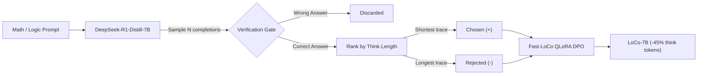

<div align="center">

# ⚡ LoCo Arena (Fast-LoCo)

### *Think Less, Locally — Cut ~45% of reasoning tokens. Same answers.*

[](LICENSE)
[](https://www.python.org/)
[](https://fastapi.tiangolo.com)
[](docker-compose.yml)
[](ollama/Modelfile)
[](https://github.com/MuyaoYuan/LoCo)

A high-performance real-time A/B benchmarking arena and lightweight training pipeline for **LoCo ("Think Less, Locally")** on `DeepSeek-R1-Distill-Qwen-7B`.

[Quickstart (1 Command)](#-quickstart-in-1-click) • [Arena Interface](#-live-side-by-side-arena) • [How LoCo Works](#-how-loco-works) • [Training Pipeline](#-training-your-own-fast-loco) • [Ollama & vLLM](#-serving-with-vllm--ollama)

</div>

---

## ⚡ 3-Second Hook

> **The Problem:** DeepSeek-R1-Distill-7B suffers from *chronic overthinking*. For simple questions like *"Which is bigger: 9.11 or 9.9?"*, it often burns 800+ tokens in circular self-doubt loops ("Wait, let me double check...").
>
> **The Solution:** LoCo uses **Local Direct Preference Optimization (DPO)** to cut **40% to 45% of redundant reasoning tokens** while preserving or improving accuracy.
>
> **LoCo Arena** lets you stream the original baseline and the LoCo-optimized model side-by-side in real-time, watching token counters, TTFT, and latency savings live.

---

## 🖥️ Live Side-by-Side Arena

```
┌────────────────────────────────────────────────────────────────────────────────────────┐
│  LoCo Arena [demo mode]                       9.9 vs 9.11 · Strawberry · Bat & Ball... │
├───────────────────────────────────────────┬────────────────────────────────────────────┤
│  A · Baseline (DeepSeek-R1-Distill-7B)    │  B · LoCo (LoCo-7B)                       │
│  [Still deliberating... +342 tokens]     │  [✓ Finished — 3.82s]                      │
│                                           │                                            │
│  Elapsed: 8.412s   TTFT: 420ms   32 tok/s │  Elapsed: 3.821s   TTFT: 240ms   41 tok/s  │
│  Think: 684 tok  |  Answer: 48 tok        │  Think: 288 tok  |  Answer: 46 tok         │
│  [████████████████████████░░] 732 tokens  │  [████████░░] 334 tokens                   │
│                                           │                                            │
│  Thinking:                                │  Thinking:                                 │
│  "Let me verify if 9.11 is greater...     │  "Both numbers have integer part 9.        │
│   Wait, let me double-check place values. │   Comparing tenths place: 9.90 > 9.11.     │
│   Could this be version numbering?        │   Hence 9.9 is greater."                   │
│   Let me re-verify 9.90 - 9.11..."        │                                            │
│                                           │  Answer:                                   │
│  Answer:                                  │  The greater number is 9.9.                │
│  (Waiting for thinking to finish...)      │  Final answer: \boxed{9.9}                 │
├───────────────────────────────────────────┴────────────────────────────────────────────┤
│  ⚡ Summary: -57.9% thinking tokens · -54.4% total tokens · -54.6% latency · Winner: LoCo│
└────────────────────────────────────────────────────────────────────────────────────────┘
```

---

## 🚀 Quickstart in 1 Click

You can test LoCo Arena immediately on your machine — **no GPU required** (runs in zero-GPU realistic simulator mode by default):

### Option A: Docker Compose (Recommended)

```bash
git clone https://github.com/your-username/loco-arena.git
cd loco-arena
docker compose up --build
```
Open **[http://localhost:8080](http://localhost:8080)** in your browser!

### Option B: Local Python & Browser

```bash
# Terminal 1: Backend
cd backend
python -m venv .venv
# Linux/macOS: source .venv/bin/activate | Windows: .venv\Scripts\activate
pip install -r requirements.txt
uvicorn app.main:app --host 0.0.0.0 --port 8000

# Terminal 2: Frontend (static server)
cd frontend
python -m http.server 8080
```
Open **[http://localhost:8080?api=http://localhost:8000](http://localhost:8080?api=http://localhost:8000)**.

---

## 🧠 How LoCo Works

The core philosophy from the paper [**"LoCo: Think Less, Locally"** (MuyaoYuan/LoCo)](https://github.com/MuyaoYuan/LoCo) is:

1. **Same destination, shorter path:** Filter reasoning traces that reach the **exact same correct answer** in `\boxed{...}`.
2. **Preference optimization:** Treat concise, direct reasoning traces as `chosen` and redundant, circular verification traces as `rejected`.
3. **Local DPO:** Train adapters directly on consumer hardware without complex multi-agent reward modeling.



---

## 📊 Benchmark Presets

The Arena includes 5 built-in benchmark presets where standard R1 models suffer from extreme overthinking:

| Preset | Domain | Why Baseline Overthinks | Expected LoCo Gain |
|---|---|---|---|
| **9.11 vs 9.9** | Math | Confuses decimal values with software version numbers; enters loops. | **~50%–60% fewer think tokens** |
| **Strawberry 'r'** | Logic | Tokenizer splits into subwords; model loops trying to spell characters. | **~45%–55% fewer think tokens** |
| **Bat & Ball ($1.10)** | Math | Second-guesses intuitive 10¢ trap repeatedly with multiple algebraic steps. | **~40%–50% fewer think tokens** |
| **2^2025 mod 7** | Math | Cycles through Fermat's Little Theorem vs Euler's totient multiple times. | **~45%–55% fewer think tokens** |
| **Knights & Knaves** | Logic | Self-referential paradox creates circular truth-table proofs. | **~40%–50% fewer think tokens** |

*(Reference: Reported by the LoCo authors, local DPO cuts ~40%–45% of reasoning tokens on benchmark distributions with equal or better accuracy).*

---

## 🛠️ Serving with vLLM & Ollama

To run real models in **`live`** mode instead of the simulator:

### 1. vLLM (Docker Compose Profile)

Set in your `.env` file (copied from `.env.example`):
```env
ARENA_MODE=live
BASELINE_BASE_URL=http://vllm-baseline:8000/v1
LOCO_BASE_URL=http://vllm-loco:8000/v1
```

Run both models with GPU acceleration:
```bash
docker compose --profile gpu up --build
```

### 2. Ollama Integration

1. Build the LoCo Modelfile:
   ```bash
   ollama create loco -f ollama/Modelfile
   ollama pull deepseek-r1:7b
   ```

2. Point the Arena to your Ollama daemon:
   ```env
   ARENA_MODE=live
   BASELINE_BASE_URL=http://host.docker.internal:11434/v1
   BASELINE_MODEL=deepseek-r1:7b
   LOCO_BASE_URL=http://host.docker.internal:11434/v1
   LOCO_MODEL=loco
   ```

---

## 🏋️ Training Your Own Fast-LoCo

We provide a lightweight training pipeline in `training/` optimized for **16GB to 24GB VRAM** consumer GPUs using QLoRA 4-bit and TRL's `DPOTrainer`.

```bash
cd training

# 1. Validate dataset format on CPU (Zero model weights download)
python train_dpo_lite.py --data data/sample_pairs.jsonl --dry-run

# 2. Train QLoRA DPO adapter on a 16GB or 24GB GPU
python train_dpo_lite.py \
    --data data/sample_pairs.jsonl \
    --output-dir out/loco-lora \
    --max-length 2048 \
    --learning-rate 5e-6

# 3. Merge LoRA adapter into standalone 16-bit checkpoint
python merge_lora.py \
    --adapter out/loco-lora \
    --output-dir out/loco-merged

# 4. Generate custom DPO pairs from your own problem set
python build_pairs.py \
    --input-file data/problems.jsonl \
    --output-file data/my_pairs.jsonl \
    --base-url http://localhost:8001/v1
```

---

## 📡 API & SSE Streaming Contract

The backend streams Server-Sent Events from `GET /api/arena/stream?prompt=...`:

| Event Type | Model | Payload Summary |
|---|---|---|
| `start` | `baseline` \| `loco` | Model name, timestamp `t_ms` |
| `token` | `baseline` \| `loco` | Phase (`think` \| `answer`), token `text`, live `metrics` |
| `phase` | `baseline` \| `loco` | Phase transition event when `</think>` closes |
| `done` | `baseline` \| `loco` | Final per-model `metrics` snapshot |
| `arena_done` | *all* | Final comparative `summary` (savings %, winner). Client closes stream. |

---

## 📂 Project Architecture

```
loco-arena/
├── docker-compose.yml          # Stack orchestration (backend + frontend + vLLM/Ollama)
├── CONTRACT.md                 # Binding API and wire-format interface contract
├── Makefile                    # Developer shortcuts
├── ollama/
│   ├── Modelfile               # LoCo-7B Ollama template with R1 prefill
│   └── Modelfile.baseline      # DeepSeek-R1-Distill-7B baseline template
├── backend/
│   ├── app/
│   │   ├── main.py             # FastAPI server with concurrent SSE orchestrator
│   │   ├── inference.py        # Async live streaming client + zero-GPU demo simulator
│   │   ├── think_parser.py     # Incremental chunk-boundary safe <think> parser
│   │   ├── metrics.py          # Real-time TTFT, tok/s, token counters & summary
│   │   └── schemas.py          # Pydantic v2 event schemas
│   ├── presets.json            # 5 classic overthinking math & logic benchmarks
│   └── tests/                  # Pytest test suite for parser and SSE streaming
├── frontend/
│   ├── index.html              # High-contrast, responsive dark UI
│   ├── app.js                  # Vanilla ES6 client, requestAnimationFrame loop, SSE
│   ├── styles.css              # Custom styling, race glow, and animated counters
│   └── nginx.conf              # SSE-safe proxy configuration
└── training/
    ├── train_dpo_lite.py       # QLoRA 4-bit DPO trainer (16-24GB VRAM)
    ├── merge_lora.py           # LoRA weight fusion to FP16/BF16
    ├── build_pairs.py          # Automated concise vs redundant pair miner
    └── data/sample_pairs.jsonl # Sample DPO training pairs
```

---

## 📜 Citation & Acknowledgements

If you use or build upon this project, please cite the original LoCo paper:

```bibtex
@misc{yuan2025loco,
  title={LoCo: Think Less, Locally},
  author={Yuan, Muyao and contributors},
  year={2025},
  howpublished={\url{https://github.com/MuyaoYuan/LoCo}}
}
```

Special thanks to the open-source LLM community: **DeepSeek AI** (DeepSeek-R1 distillations), **Qwen Team** (Qwen 2.5), **Hugging Face** (`trl`, `peft`, `transformers`), and **vLLM** / **Ollama**.

---

## 📄 License

Licensed under the [Apache License 2.0](LICENSE).
